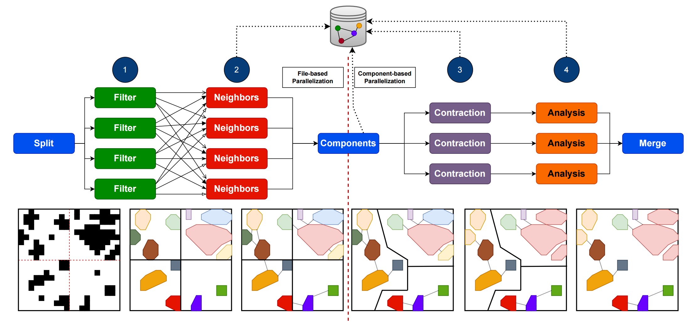

# Settlement Delineation and Analysis (SDA)
Delineate urban clusters using a settlement graph and [edge contraction](https://en.wikipedia.org/wiki/Edge_contraction) and then analyze the centrality of the aggregated settlement clusters. It is based on the [Fishnet](https://gitlab2.informatik.uni-wuerzburg.de/descartes/sos/fishnet) framework.

.
### Deployment
To run the **Settlement Delineation and Analysis** workflow, the easiest way is to use [SettlementDelineationAnalysis.py](SettlementDelineationAnalysis.py), which wraps the command line interface of the [main binary](src/0_workflow/SettlementDelineation.cpp) and executes it in a container using [docker](prod/docker/Dockerfile.db) (which has to be installed in the deployment environment). 
```
python3 SettlementDelineationAnalysis.py -i <input> -c <config>.json -o <output>.shp
``` 
- **input**: Input GIS file (*GeoTIFF* | *Shapefile*) on settlement location (e.g. [WSF](https://geoservice.dlr.de/web/maps/eoc:wsf2019))
- **config**: JSON file containing the config for the workflow run (e.g. [Example Config](prod/docker/sda-docker.json) )
- **output**: Path of output shapefile  
### Development
Alternatively the **SDA** workflow can be installed on the system using the [install](install.sh) script. Make sure that the install prefix location is referenced in *PATH* (e.g. *usr/local/bin*). 
```shell
./install.sh
```
Additionally, a cwl runner must be installed to execute the individual stages of the workflow. The reference executor [cwltool](https://cwltool.readthedocs.io/en/latest/cli.html#cwltool) is recommended and can be installed as follows:
```shell
sudo apt-get install cwltool
```
Furthermore, a running instance of the **Memgraph** database joined with the **Memgraph Lab** web interface can be obtained using docker compose:
```shell
cd prod/local
docker compose up -d
```
The workflow can then be executed as follows:
```shell
SettlementDelineation -i <path-to-input> -c <path-to-cfg> -o <path-to-output.shp>
```


